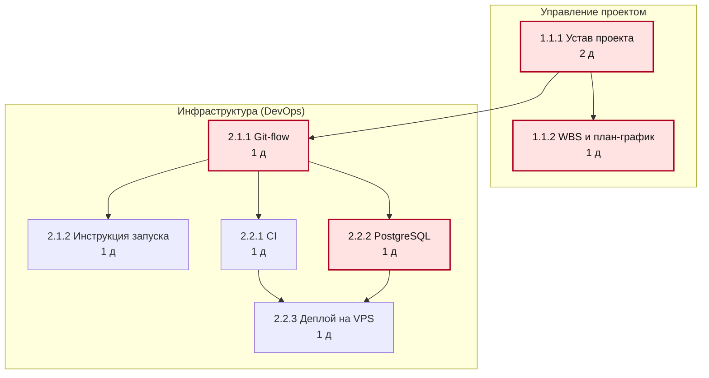
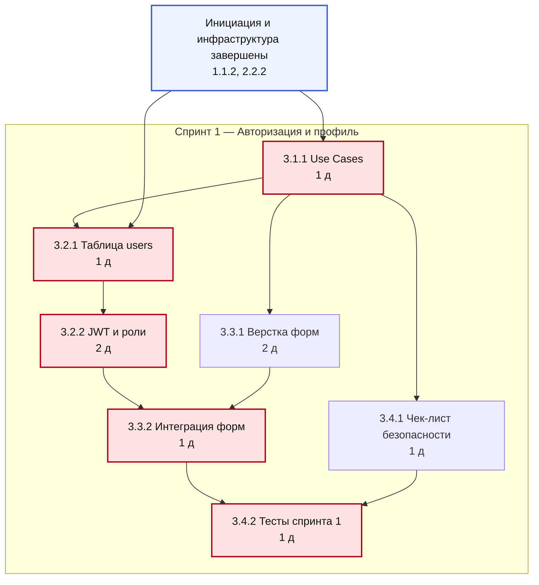
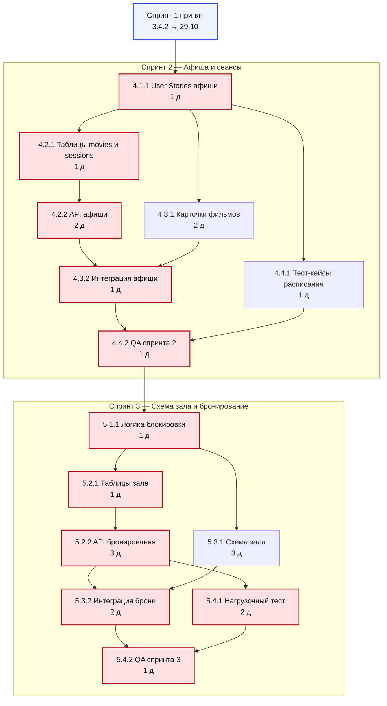
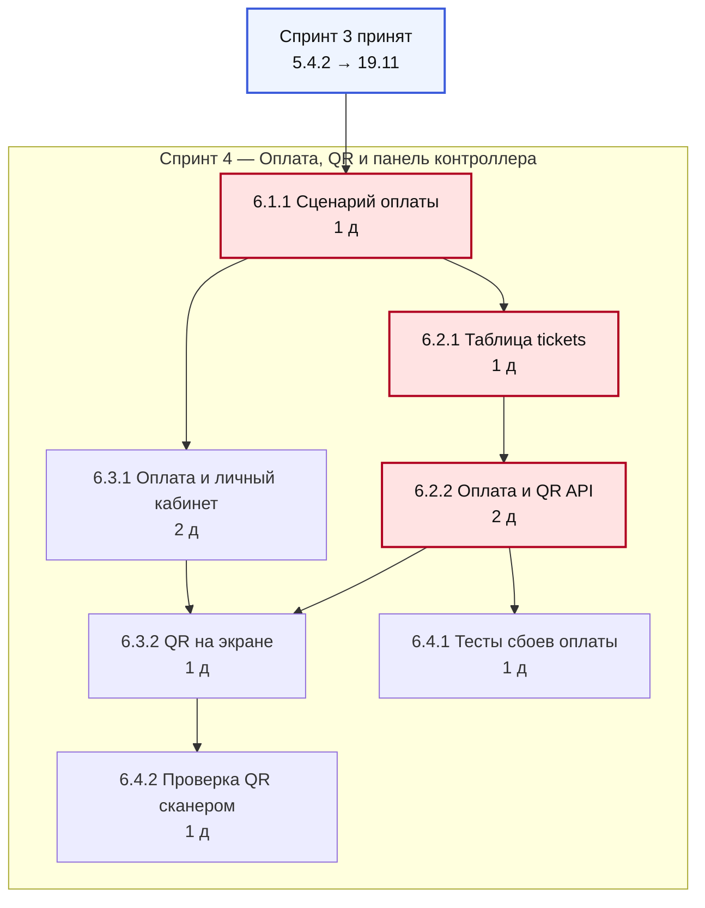
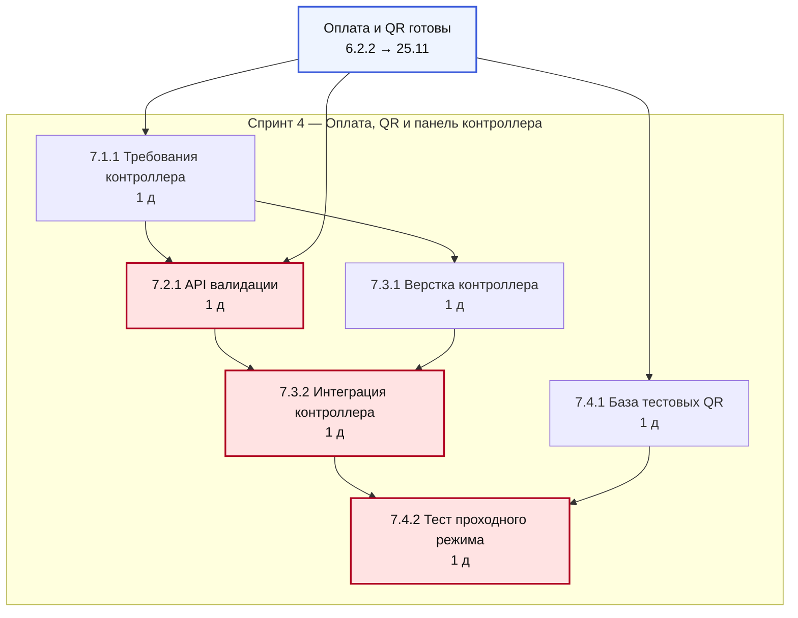
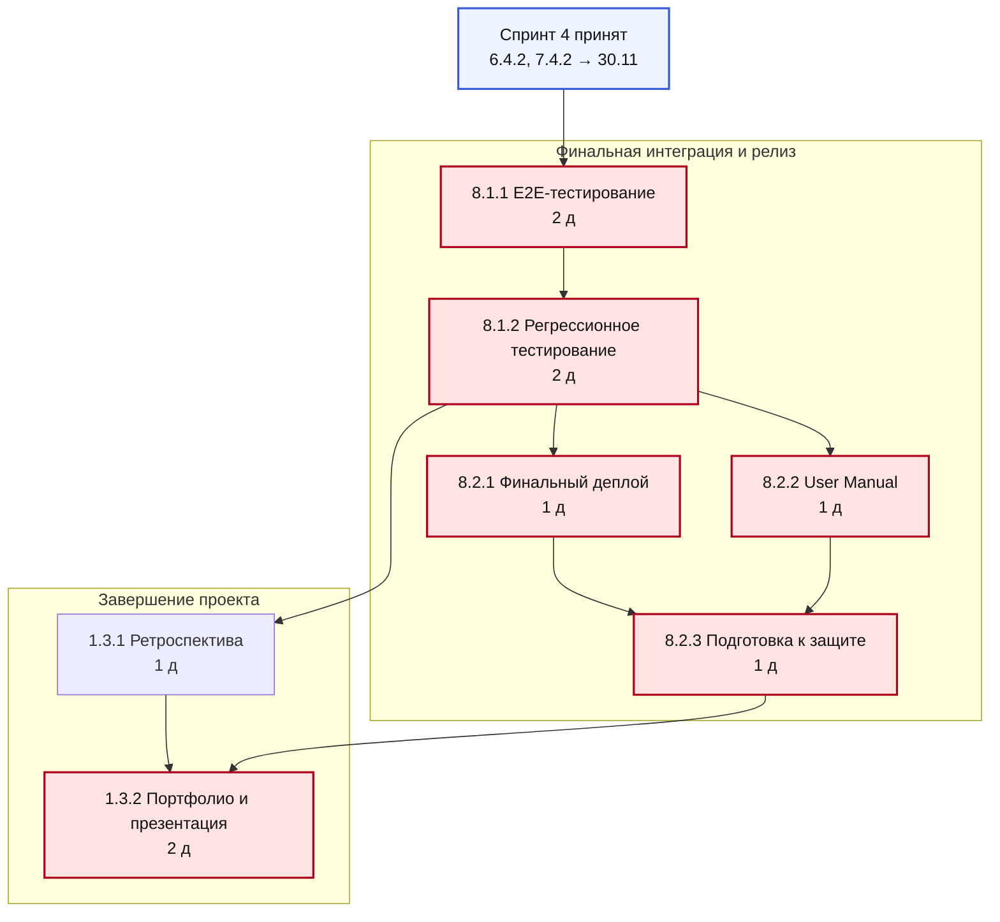
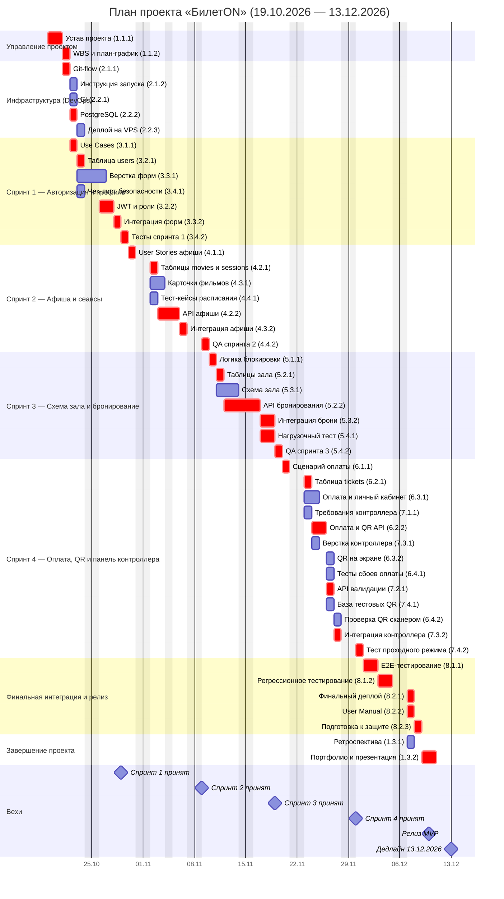

# Лабораторная работа №6. Планирование расписания проекта

**Проект:** «БилетON» — онлайн-сервис бронирования билетов в кино (шифр ВПР41)
**Команда:** Лебедев Иван (PM/Backend), Цихоцкий Андрей (Аналитик/QA),
Байдак Артём (Lead Dev/Backend), Скляров Антон (Frontend/QA)
**Дата выполнения:** 05.11.2026

---

## 1. Исходные данные и допущения

Расписание строится на основе WBS из лабораторной работы №4 и оценок трудоёмкости
из лабораторной работы №5. Новые оценки не вводятся — это позволяет сохранить
преемственность документов проекта.

| Параметр | Значение |
| :--- | :--- |
| Период планирования | 19.10.2026 — 13.12.2026 (8 недель) |
| Рабочий календарь | 5-дневная неделя, пн–пт |
| Нерабочие дни | 4 ноября 2026 (День народного единства) |
| Доступный фонд | 39 рабочих дней |
| Единица длительности | 1 день = 5 ч работы одного исполнителя |
| Округление | до целого дня: 0,5 и более — вверх, но не менее 1 дня |
| Тип связей | «конец → начало» (FS); лагов нет |
| Оценки | плановые (baseline), фактические даты спринта 1 не учитываются |

**Состав задач.** В сетевой график включены 48 задач нижнего уровня WBS.
Из 51 пакета исключены три поточные работы: 1.2.1 (модерация Scrum-событий),
1.2.2 (участие в летучках) и 1.2.3 (ведение реестра рисков). У этих работ нет
конечного продукта и фиксированной даты завершения: они выполняются параллельно
всему проекту, поэтому в расчёте критического пути не участвуют. Их трудоёмкость
(40 ч) учтена в загрузке команды, но не в длительности проекта.

**Округление.** Трудоёмкость 283 ч при норме 5 ч/день даёт 56,6 «чистых»
человеко-дней. После округления до целых дней суммарная длительность задач
составляет 64 дня.
Короткие задачи (2–3 ч) занимают минимум один день, поэтому план
консервативнее расчёта примерно на 13 %.

---

## 2. Перечень задач и логические зависимости

| ID | Задача | Роль | Трудоёмкость, ч | Длительность, дн | Предшественники |
| :--- | :--- | :--- | ---: | ---: | :--- |
| 1.1.1 | Разработка Устава проекта | PM | 8 | 2 | — |
| 1.1.2 | Декомпозиция WBS и план-график | Вся команда | 4 | 1 | 1.1.1 |
| 1.3.1 | Финальная ретроспектива | Вся команда | 2 | 1 | 8.1.2 |
| 1.3.2 | Портфолио и презентация к защите | PM | 8 | 2 | 1.3.1, 8.2.3 |
| 2.1.1 | Git-репозиторий и Git-flow | PM/Backend | 4 | 1 | 1.1.1 |
| 2.1.2 | Инструкция по локальному запуску | Lead Dev | 4 | 1 | 2.1.1 |
| 2.2.1 | Пайплайн CI (GitHub Actions) | PM/Backend | 6 | 1 | 2.1.1 |
| 2.2.2 | Локальная СУБД PostgreSQL | QA | 4 | 1 | 2.1.1 |
| 2.2.3 | Скрипты деплоя на VPS | Lead Dev | 6 | 1 | 2.2.1, 2.2.2 |
| 3.1.1 | Use Cases и DoD авторизации | Аналитик/QA | 4 | 1 | 1.1.2 |
| 3.2.1 | Проектирование таблицы users | PM/Backend | 4 | 1 | 3.1.1, 2.2.2 |
| 3.2.2 | JWT-авторизация и разграничение ролей | Lead Dev | 12 | 2 | 3.2.1 |
| 3.3.1 | Верстка страниц входа и регистрации | Frontend | 8 | 2 | 3.1.1 |
| 3.3.2 | Интеграция форм с API авторизации | Frontend | 6 | 1 | 3.2.2, 3.3.1 |
| 3.4.1 | Чек-лист тестирования безопасности | Аналитик/QA | 2 | 1 | 3.1.1 |
| 3.4.2 | Прогон тестов и баг-репорты спринта 1 | Frontend/QA | 4 | 1 | 3.3.2, 3.4.1 |
| 4.1.1 | User Stories афиши и расписания | Аналитик | 2 | 1 | 3.4.2 |
| 4.2.1 | Таблицы movies и sessions | PM/Backend | 6 | 1 | 4.1.1 |
| 4.2.2 | API GET /movies и /sessions | Lead Dev | 8 | 2 | 4.2.1 |
| 4.3.1 | Верстка карточек и выбора сеанса | Frontend | 10 | 2 | 4.1.1 |
| 4.3.2 | Интеграция афиши с API | Frontend | 6 | 1 | 4.2.2, 4.3.1 |
| 4.4.1 | Тест-кейсы пустого расписания | Аналитик/QA | 2 | 1 | 4.1.1 |
| 4.4.2 | QA верстки и исправление багов спринта 2 | Frontend/QA | 6 | 1 | 4.3.2, 4.4.1 |
| 5.1.1 | Логика блокировки мест при бронировании | Аналитик | 4 | 1 | 4.4.2 |
| 5.2.1 | Таблицы halls, seats, bookings | PM/Backend | 6 | 1 | 5.1.1 |
| 5.2.2 | API POST /bookings (SELECT FOR UPDATE) | Lead Dev | 16 | 3 | 5.2.1 |
| 5.3.1 | Верстка интерактивной схемы зала | Frontend | 14 | 3 | 5.1.1 |
| 5.3.2 | Интеграция брони и обработка HTTP 409 | Frontend | 8 | 2 | 5.2.2, 5.3.1 |
| 5.4.1 | Нагрузочный тест одновременного бронирования | Аналитик/QA | 8 | 2 | 5.2.2 |
| 5.4.2 | Прогон сценариев спринта 3 | Frontend/QA | 6 | 1 | 5.3.2, 5.4.1 |
| 6.1.1 | Сценарий оплаты и формат данных QR | Аналитик | 3 | 1 | 5.4.2 |
| 6.2.1 | Таблица tickets и связь с bookings | PM/Backend | 4 | 1 | 6.1.1 |
| 6.2.2 | Имитация оплаты и API генерации QR | Lead Dev | 12 | 2 | 6.2.1 |
| 6.3.1 | Верстка оплаты и личного кабинета | Frontend | 8 | 2 | 6.1.1 |
| 6.3.2 | Отрисовка QR-кода на экране | Frontend | 6 | 1 | 6.2.2, 6.3.1 |
| 6.4.1 | Тестирование сбоев оплаты | Аналитик/QA | 4 | 1 | 6.2.2 |
| 6.4.2 | Проверка QR-кода сканером | Frontend/QA | 4 | 1 | 6.3.2 |
| 7.1.1 | Требования к панели контроллера | Аналитик | 2 | 1 | 6.1.1 |
| 7.2.1 | API валидации билета | Lead Dev | 6 | 1 | 7.1.1, 6.2.2 |
| 7.3.1 | Верстка панели контроллера | Frontend | 6 | 1 | 7.1.1 |
| 7.3.2 | Интеграция панели с API валидации | Frontend | 4 | 1 | 7.2.1, 7.3.1 |
| 7.4.1 | База тестовых QR-кодов | Аналитик/QA | 4 | 1 | 6.2.2 |
| 7.4.2 | Тестирование проходного режима | Frontend/QA | 4 | 1 | 7.3.2, 7.4.1 |
| 8.1.1 | E2E: от регистрации до прохода по QR | Вся команда | 8 | 2 | 6.4.1, 6.4.2, 7.4.2 |
| 8.1.2 | Регрессионное тестирование | Аналитик/QA | 8 | 2 | 8.1.1 |
| 8.2.1 | Деплой финальной версии на сервер | Lead Dev | 4 | 1 | 8.1.2 |
| 8.2.2 | Написание User Manual | PM | 4 | 1 | 8.1.2 |
| 8.2.3 | Подготовка к защите проекта | Вся команда | 4 | 1 | 8.2.1, 8.2.2 |

---

## 3. Диаграмма предшествования (PDM)

Все связи — типа FS («конец → начало»): задача-последователь может начаться
только после завершения всех перечисленных предшественников. Красным выделены
задачи критического пути (TF = 0).

Сеть из 48 задач в одном рисунке нечитаема, поэтому она разделена на шесть
фрагментов по границам спринтов. Полный перечень связей приведён в таблице
раздела 2. Пунктирный блок в начале рисунков 2–6 — точка входа: завершённые
задачи предыдущего фрагмента, от которых зависят первые задачи этого.

**Рисунок 1 — инициация и инфраструктура.**

**Рисунок 2 — спринт 1 (авторизация и профиль).**

**Рисунок 3 — спринты 2 и 3 (афиша, бронирование).**

**Рисунок 4 — спринт 4, часть 1: оплата и генерация QR.**

**Рисунок 5 — спринт 4, часть 2: панель контроллера.** Точка входа — API
генерации QR (6.2.2) и сценарий оплаты (6.1.1) из предыдущего рисунка.

**Рисунок 6 — финальная интеграция, релиз и завершение.**

---

## 4. Расчёт ранних и поздних сроков

### 4.1. Формулы

Прямой проход (ранние сроки):

- `ES = max(EF предшественников)`, для задач без предшественников `ES = 0`;
- `EF = ES + D`.

Обратный проход (поздние сроки):

- `LF = min(LS последователей)`, для последних задач `LF = T` (длительность проекта);
- `LS = LF − D`.

Резервы:

- общий резерв `TF = LS − ES = LF − EF`;
- свободный резерв `FF = min(ES последователей) − EF`.

Длительность проекта `T = max(EF)`.

### 4.2. Пример ручного расчёта

**Прямой проход для задачи 5.2.2 «API POST /bookings».**
Предшественник 5.2.1 заканчивается на дне 17, значит
`ES(5.2.2) = 17`. Длительность — 3 дня,
поэтому `EF = 17 + 3 = 20`.

**Обратный проход для той же задачи.**
У 5.2.2 два последователя: 5.3.2 и 5.4.1. Их поздние начала равны
20 и 20, следовательно
`LF(5.2.2) = min(20; 20) = 20`,
а `LS = 20 − 3 = 17`.

**Резервы.** `TF = 17 − 17 = 0`,
`FF = 0`. Нулевые резервы означают, что задержка этой задачи
на один день сдвигает весь проект на один день.

### 4.3. Результаты расчёта

ES, EF, LS, LF — номера рабочих дней от начала проекта (день 0 — 19.10.2026).

| ID | D | ES | EF | LS | LF | TF | FF | Начало | Окончание |
| :--- | ---: | ---: | ---: | ---: | ---: | ---: | ---: | :--- | :--- |
| 1.1.1 | 2 | 0 | 2 | 0 | 2 | 0 | 0 | 19.10.2026 | 20.10.2026 |
| 1.1.2 | 1 | 2 | 3 | 2 | 3 | 0 | 0 | 21.10.2026 | 21.10.2026 |
| 1.3.1 | 1 | 34 | 35 | 35 | 36 | 1 | 1 | 07.12.2026 | 07.12.2026 |
| 1.3.2 | 2 | 36 | 38 | 36 | 38 | 0 | 0 | 09.12.2026 | 10.12.2026 |
| 2.1.1 | 1 | 2 | 3 | 2 | 3 | 0 | 0 | 21.10.2026 | 21.10.2026 |
| 2.1.2 | 1 | 3 | 4 | 37 | 38 | 34 | 34 | 22.10.2026 | 22.10.2026 |
| 2.2.1 | 1 | 3 | 4 | 36 | 37 | 33 | 0 | 22.10.2026 | 22.10.2026 |
| 2.2.2 | 1 | 3 | 4 | 3 | 4 | 0 | 0 | 22.10.2026 | 22.10.2026 |
| 2.2.3 | 1 | 4 | 5 | 37 | 38 | 33 | 33 | 23.10.2026 | 23.10.2026 |
| 3.1.1 | 1 | 3 | 4 | 3 | 4 | 0 | 0 | 22.10.2026 | 22.10.2026 |
| 3.2.1 | 1 | 4 | 5 | 4 | 5 | 0 | 0 | 23.10.2026 | 23.10.2026 |
| 3.2.2 | 2 | 5 | 7 | 5 | 7 | 0 | 0 | 26.10.2026 | 27.10.2026 |
| 3.3.1 | 2 | 4 | 6 | 5 | 7 | 1 | 1 | 23.10.2026 | 26.10.2026 |
| 3.3.2 | 1 | 7 | 8 | 7 | 8 | 0 | 0 | 28.10.2026 | 28.10.2026 |
| 3.4.1 | 1 | 4 | 5 | 7 | 8 | 3 | 3 | 23.10.2026 | 23.10.2026 |
| 3.4.2 | 1 | 8 | 9 | 8 | 9 | 0 | 0 | 29.10.2026 | 29.10.2026 |
| 4.1.1 | 1 | 9 | 10 | 9 | 10 | 0 | 0 | 30.10.2026 | 30.10.2026 |
| 4.2.1 | 1 | 10 | 11 | 10 | 11 | 0 | 0 | 02.11.2026 | 02.11.2026 |
| 4.2.2 | 2 | 11 | 13 | 11 | 13 | 0 | 0 | 03.11.2026 | 05.11.2026 |
| 4.3.1 | 2 | 10 | 12 | 11 | 13 | 1 | 1 | 02.11.2026 | 03.11.2026 |
| 4.3.2 | 1 | 13 | 14 | 13 | 14 | 0 | 0 | 06.11.2026 | 06.11.2026 |
| 4.4.1 | 1 | 10 | 11 | 13 | 14 | 3 | 3 | 02.11.2026 | 02.11.2026 |
| 4.4.2 | 1 | 14 | 15 | 14 | 15 | 0 | 0 | 09.11.2026 | 09.11.2026 |
| 5.1.1 | 1 | 15 | 16 | 15 | 16 | 0 | 0 | 10.11.2026 | 10.11.2026 |
| 5.2.1 | 1 | 16 | 17 | 16 | 17 | 0 | 0 | 11.11.2026 | 11.11.2026 |
| 5.2.2 | 3 | 17 | 20 | 17 | 20 | 0 | 0 | 12.11.2026 | 16.11.2026 |
| 5.3.1 | 3 | 16 | 19 | 17 | 20 | 1 | 1 | 11.11.2026 | 13.11.2026 |
| 5.3.2 | 2 | 20 | 22 | 20 | 22 | 0 | 0 | 17.11.2026 | 18.11.2026 |
| 5.4.1 | 2 | 20 | 22 | 20 | 22 | 0 | 0 | 17.11.2026 | 18.11.2026 |
| 5.4.2 | 1 | 22 | 23 | 22 | 23 | 0 | 0 | 19.11.2026 | 19.11.2026 |
| 6.1.1 | 1 | 23 | 24 | 23 | 24 | 0 | 0 | 20.11.2026 | 20.11.2026 |
| 6.2.1 | 1 | 24 | 25 | 24 | 25 | 0 | 0 | 23.11.2026 | 23.11.2026 |
| 6.2.2 | 2 | 25 | 27 | 25 | 27 | 0 | 0 | 24.11.2026 | 25.11.2026 |
| 6.3.1 | 2 | 24 | 26 | 26 | 28 | 2 | 1 | 23.11.2026 | 24.11.2026 |
| 6.3.2 | 1 | 27 | 28 | 28 | 29 | 1 | 0 | 26.11.2026 | 26.11.2026 |
| 6.4.1 | 1 | 27 | 28 | 29 | 30 | 2 | 2 | 26.11.2026 | 26.11.2026 |
| 6.4.2 | 1 | 28 | 29 | 29 | 30 | 1 | 1 | 27.11.2026 | 27.11.2026 |
| 7.1.1 | 1 | 24 | 25 | 26 | 27 | 2 | 0 | 23.11.2026 | 23.11.2026 |
| 7.2.1 | 1 | 27 | 28 | 27 | 28 | 0 | 0 | 26.11.2026 | 26.11.2026 |
| 7.3.1 | 1 | 25 | 26 | 27 | 28 | 2 | 2 | 24.11.2026 | 24.11.2026 |
| 7.3.2 | 1 | 28 | 29 | 28 | 29 | 0 | 0 | 27.11.2026 | 27.11.2026 |
| 7.4.1 | 1 | 27 | 28 | 28 | 29 | 1 | 1 | 26.11.2026 | 26.11.2026 |
| 7.4.2 | 1 | 29 | 30 | 29 | 30 | 0 | 0 | 30.11.2026 | 30.11.2026 |
| 8.1.1 | 2 | 30 | 32 | 30 | 32 | 0 | 0 | 01.12.2026 | 02.12.2026 |
| 8.1.2 | 2 | 32 | 34 | 32 | 34 | 0 | 0 | 03.12.2026 | 04.12.2026 |
| 8.2.1 | 1 | 34 | 35 | 34 | 35 | 0 | 0 | 07.12.2026 | 07.12.2026 |
| 8.2.2 | 1 | 34 | 35 | 34 | 35 | 0 | 0 | 07.12.2026 | 07.12.2026 |
| 8.2.3 | 1 | 35 | 36 | 35 | 36 | 0 | 0 | 08.12.2026 | 08.12.2026 |

---

## 5. Критический путь

Критический путь — цепочка задач с нулевым общим резервом. Длина критического
пути равна длительности проекта: **38 рабочих дней**, плановая дата
завершения — **10.12.2026**.

### 5.1. Главная критическая цепочка

| Участок | Задачи | Длина, дн |
| :--- | :--- | ---: |
| Инициация и инфраструктура | 1.1.1 → 2.1.1 → 2.2.2 | 4 |
| Спринт 1 | 3.2.1 → 3.2.2 → 3.3.2 → 3.4.2 | 5 |
| Спринт 2 | 4.1.1 → 4.2.1 → 4.2.2 → 4.3.2 → 4.4.2 | 6 |
| Спринт 3 | 5.1.1 → 5.2.1 → 5.2.2 → 5.3.2 → 5.4.2 | 8 |
| Спринт 4, релиз и завершение | 6.1.1 → 6.2.1 → 6.2.2 → 7.2.1 → 7.3.2 → 7.4.2 → 8.1.1 → 8.1.2 → 8.2.1 → 8.2.3 → 1.3.2 | 15 |
| **Итого** | | **38** |

### 5.2. Параллельные критические ветви

Кроме главной цепочки, нулевой резерв имеют ещё 4 задачи:
**1.1.2** «WBS и план-график», **3.1.1** «Use Cases», **5.4.1** «Нагрузочный тест», **8.2.2** «User Manual».

Это означает, что критических путей несколько. Например, в спринте 3
интеграция брони (5.3.2) и нагрузочный тест (5.4.1) идут параллельно, и
задержка любой из них одинаково сдвигает прогон сценариев 5.4.2. При управлении
проектом нельзя следить только за одной «красной ниткой» — все 32
задачи с TF = 0 требуют
ежедневного контроля.

---

## 6. Диаграмма Ганта

Диаграмма построена по тем же датам, что и таблица раздела 4: начало каждой
задачи совпадает с ES, окончание — с EF. Красным показаны критические задачи,
вехами отмечены приёмка спринтов, релиз и дедлайн.

---

## 7. Резервы времени некритических задач

**Общий резерв (TF)** — на сколько задача может сдвинуться, не изменяя дату
завершения проекта. **Свободный резерв (FF)** — на сколько задача может
сдвинуться, не изменяя раннее начало ни одного последователя. Если FF = 0 при
большом TF, задача уже «прижата» к следующей и не имеет собственного запаса.

| ID | Задача | TF | FF | Комментарий |
| :--- | :--- | ---: | ---: | :--- |
| 3.3.1 | Верстка форм | 1 | 1 | Верстку можно задержать на 1 день без сдвига интеграции. |
| 4.3.1 | Карточки фильмов | 1 | 1 | Запас 1 день на случай правок макета. |
| 5.3.1 | Схема зала | 1 | 1 | Схему зала можно задержать на 1 день, интеграция брони не пострадает. |
| 6.3.2 | QR на экране | 1 | 0 | TF = 1, FF = 0: задерживать нельзя, иначе сдвинутся E2E-тесты. |
| 7.4.1 | База тестовых QR | 1 | 1 | Базу тестовых QR можно готовить на 1 день позже. |
| 6.4.2 | Проверка QR сканером | 1 | 1 | Проверку сканером можно сдвинуть на 1 день. |
| 1.3.1 | Ретроспектива | 1 | 1 | Ретроспективу можно провести 08.12 вместо 07.12. |
| 6.3.1 | Оплата и личный кабинет | 2 | 1 | Запас 2 дня, но FF = 1: часть работ по верстке должна быть готова к 26.11. |
| 7.1.1 | Требования контроллера | 2 | 0 | TF = 2, FF = 0: требования нужны 24.11 для верстки и API. |
| 7.3.1 | Верстка контроллера | 2 | 2 | Запас 2 дня на доработку интерфейса. |
| 6.4.1 | Тесты сбоев оплаты | 2 | 2 | Тесты сбоев оплаты имеют запас 2 дня. |
| 3.4.1 | Чек-лист безопасности | 3 | 3 | Чек-лист не задерживает прогон тестов (3.4.2) больше чем на 3 дня. |
| 4.4.1 | Тест-кейсы расписания | 3 | 3 | Тест-кейсы имеют запас 3 дня. |
| 2.2.1 | CI | 33 | 0 | TF огромен, но FF = 0: CI нельзя задерживать позже 23.10 — он нужен деплою 2.2.3. |
| 2.2.3 | Деплой на VPS | 33 | 33 | Деплой на VPS не входит в критический путь. |
| 2.1.2 | Инструкция запуска | 34 | 34 | Документация не блокирует разработку, резерв почти на весь проект. |

Всего резерв имеют 16 задач из 48. Наибольший резерв — у задач
документирования и деплоя (2.1.2, 2.2.1, 2.2.3): они не лежат на критическом
пути и могут выполняться в фоновом режиме. Наименьшие резервы (1 день) — у
верстки, схемы зала и проверки QR: это «буферные» задачи, за счёт которых можно
компенсировать задержки бэкенда, но только один раз.

---

## 8. Проверка согласованности

| Проверка | Результат |
| :--- | :--- |
| `EF = ES + D` для всех задач | выполняется для 48 из 48 |
| `LS = LF − D` для всех задач | выполняется для 48 из 48 |
| `TF = LS − ES` для всех задач | выполняется для 48 из 48 |
| Длительность проекта = `max(EF)` | 38 дней |
| Сумма длительностей по главной цепочке | 38 дней |
| Задач с TF = 0 (критические) | 32 |
| Задач с TF > 0 (с резервом) | 16 |
| Даты Ганта = ES/EF из таблицы | проверено построчно |
| Резерв до дедлайна 13.12.2026 | 1 раб. дн. (11.12.2026) |

**О запасе времени.** План заканчивается 10.12.2026, до дедлайна остаётся
1 рабочий день (11.12.2026) и выходные 12–13 декабря.
Это небольшой, но реальный буфер: он покрывает только одну непредвиденную
задержку на критическом пути. Поэтому задачи с TF = 0 (прежде всего 3.2.2,
5.2.2 и 7.2.1) должны контролироваться ежедневно.

---

## 9. Связь со Scrum и выводы

Проект выполняется спринтами, поэтому диаграмма Ганта сгруппирована по секциям:
каждый спринт — отдельная секция, конец спринта — веха приёмки. Канбан-доска в
данной работе не строится: она управляет потоком задач, а не сроками, и не
участвует в расчёте критического пути. Роль средства управления потоком в
проекте выполняют GitHub Issues и Pull Requests.

**Выводы.**

1. Критический путь проходит через аналитику, бэкенд и финальное тестирование:
   инициация → инфраструктура → Use Cases → таблица users → JWT → интеграция
   форм → тесты → все последующие модули → релиз.
   Длина пути — 38 рабочих дней, финиш 10.12.2026. Это на
   один день меньше доступного фонда, поэтому запас у проекта минимальный.
2. Узкие места — задачи с нулевым резервом и единственным исполнителем:
   3.2.2 (JWT, Lead Dev), 5.2.2 (бронирование, Lead Dev), 7.2.1 (валидация
   билета, Lead Dev). Болезнь Lead Dev останавливает весь проект.
3. 16 задач имеют резерв; наибольший — у документации и деплоя.
   Эти работы можно двигать, чтобы разгрузить критический путь.
4. Общий резерв проекта — 1 рабочий день. Для его сохранения
   необходимо, чтобы задачи 3.2.2 и 5.2.2 не выходили за плановые даты.
