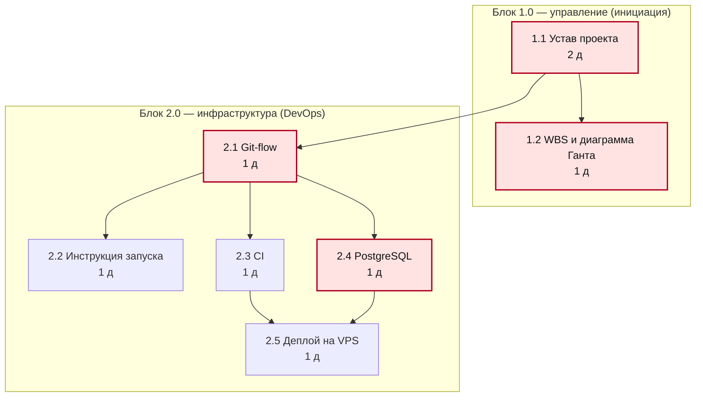
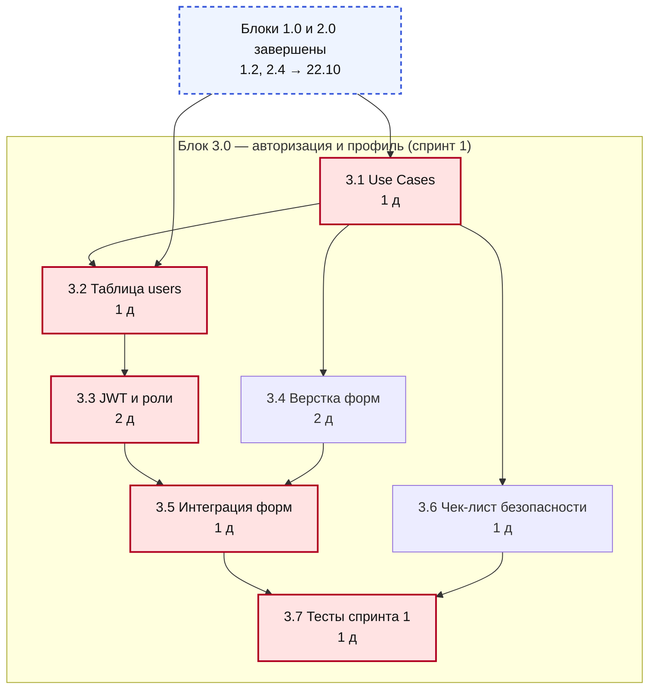
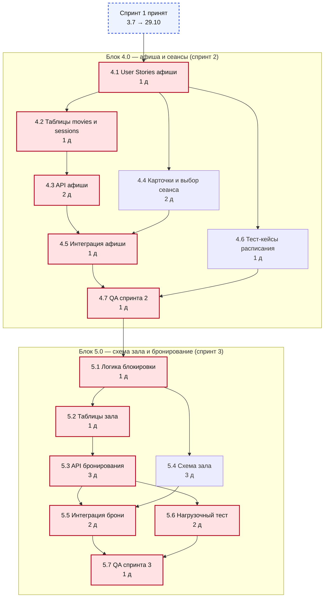
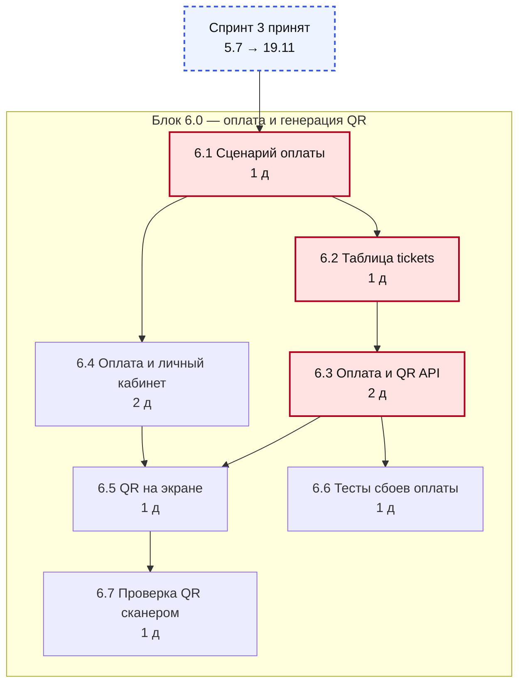
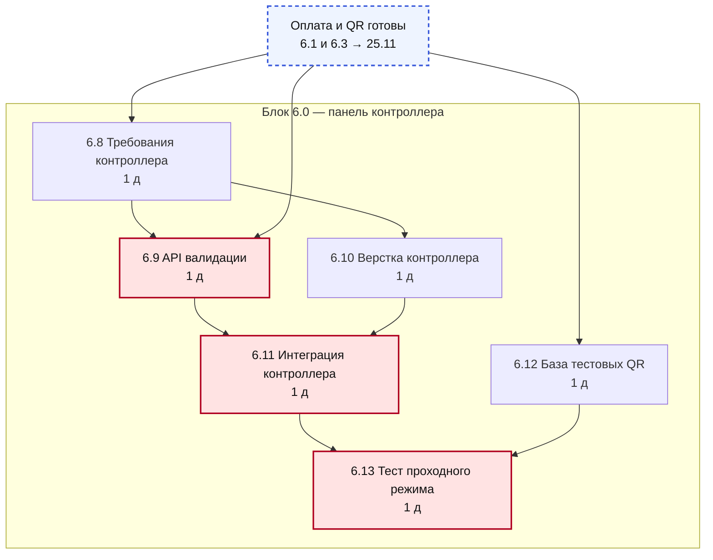
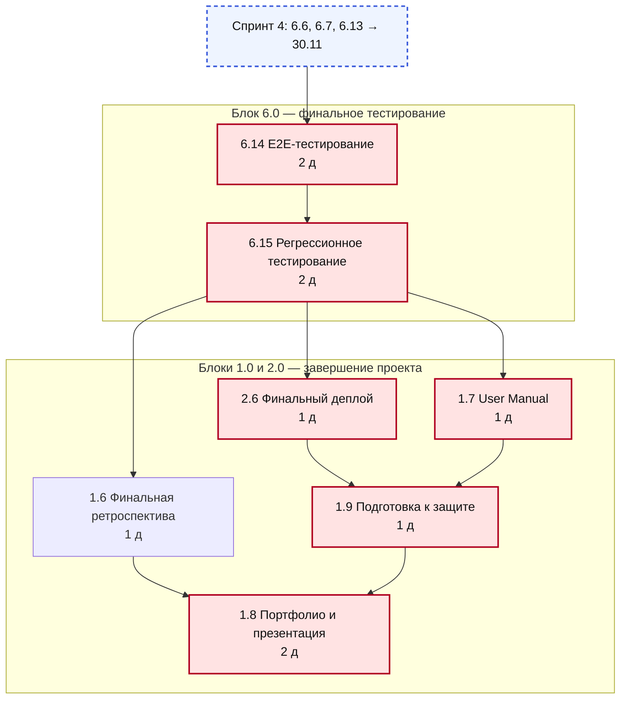

# Лабораторная работа №6. Планирование расписания проекта

**Проект:** «БилетON» — онлайн-сервис бронирования билетов в кино (шифр ВПР41)
**Команда:** Лебедев Иван (PM/Backend), Цихоцкий Андрей (Аналитик/QA),
Байдак Артём (Lead Dev/Backend), Скляров Антон (Frontend/QA)
**Дата выполнения:** 05.11.2026

---

## 1. Исходные данные и допущения

Расписание построено по обновлённой WBS (блоки 1.0–6.0) и оценкам трудоёмкости
из лабораторной работы №5. Структура WBS приведена в соответствие с замечаниями
преподавателя: блоки состоят из перечня конкретных задач без подпунктов, работы
спринта 4 объединены в один блок 6.0, а финальный деплой, User Manual и подготовка
к защите перенесены в блоки 2.0 и 1.0 (задачи 2.6, 1.7 и 1.9). Трудоёмкость и
количество задач не изменились.

| Параметр | Значение |
| :--- | :--- |
| Период планирования | 19.10.2026 — 13.12.2026 (8 недель) |
| Рабочий календарь | 5-дневная неделя, пн–пт |
| Нерабочие дни | 4 ноября 2026 (День народного единства) |
| Доступный фонд | 39 рабочих дней |
| Единица длительности | 1 день = 5 ч работы одного исполнителя |
| Округление | до целого дня: 0,5 и более — вверх, но не менее 1 дня |
| Тип связей | «конец → начало» (FS); в расчёте CPM — без лагов |
| Оценки | плановые (baseline), фактические даты спринта 1 не учитываются |

**Состав задач.** В WBS 51 задача нижнего уровня. В сетевой график включены 48:
три работы выполняются параллельно всему проекту и не имеют конечного продукта
с фиксированной датой завершения, поэтому в расчёте критического пути не
участвуют.

| Исключённая работа (LOE) | Роль | Трудоёмкость |
| :--- | :--- | ---: |
| 1.3 Модерация Scrum-событий | PM | 16 ч |
| 1.4 Участие в летучках и обновление статусов | Вся команда | 16 ч |
| 1.5 Ведение реестра рисков и EVM | PM | 8 ч |
| **Итого** | | **40 ч** |

Их трудоёмкость учтена в загрузке команды, но не в длительности проекта.

**Округление.** Трудоёмкость 48 задач — 283 ч, при норме 5 ч/день это 56,6
«чистых» человеко-дней. После округления до целых дней суммарная длительность
задач составляет 64 дня. Короткие задачи (2–3 ч) занимают минимум
один день, поэтому план консервативнее расчёта примерно на 13 %.

---

## 2. Перечень задач и логические зависимости

| ID | Задача | Роль | Трудоёмкость, ч | Длительность, дн | Предшественники |
| :--- | :--- | :--- | ---: | ---: | :--- |
| 1.1 | Разработка Устава проекта, согласование со стейкхолдерами | PM | 8 | 2 | — |
| 1.2 | Декомпозиция WBS, построение диаграммы Ганта | Вся команда | 4 | 1 | 1.1 |
| 1.6 | Финальная ретроспектива (Start-Stop-Continue) | Вся команда | 2 | 1 | 6.15 |
| 1.7 | Внедрение и сопровождение User Manual (инструкции для пользователя и контроллера) | PM | 4 | 1 | 6.15 |
| 1.8 | Сборка портфолио и подготовка презентации к защите | PM | 8 | 2 | 1.6, 1.9 |
| 1.9 | Подготовка к защите, сдача проекта 13 декабря | Вся команда | 4 | 1 | 2.6, 1.7 |
| 2.1 | Инициализация Git-репозитория, настройка Git-flow (main, dev, feature) | PM/Backend | 4 | 1 | 1.1 |
| 2.2 | Разработка инструкции по локальному запуску проекта (readme) | Lead Dev | 4 | 1 | 2.1 |
| 2.3 | Настройка пайплайна CI (GitHub Actions для автозапуска линтеров и тестов) | PM/Backend | 6 | 1 | 2.1 |
| 2.4 | Развертывание локальной СУБД PostgreSQL для тестов | QA | 4 | 1 | 2.1 |
| 2.5 | Настройка скриптов деплоя на тестовый сервер (VPS) | Lead Dev | 6 | 1 | 2.3, 2.4 |
| 2.6 | Деплой финальной версии на сервер | Lead Dev | 4 | 1 | 6.15 |
| 3.1 | Написание Use Cases и критериев DoD для входа/регистрации | Аналитик/QA | 4 | 1 | 1.2 |
| 3.2 | Проектирование и создание таблицы users | PM/Backend | 4 | 1 | 3.1, 2.4 |
| 3.3 | Реализация JWT-авторизации и разграничения ролей (зритель/контроллер) | Lead Dev | 12 | 2 | 3.2 |
| 3.4 | Верстка страниц входа и регистрации по макету | Frontend | 8 | 2 | 3.1 |
| 3.5 | Интеграция форм с API авторизации (сохранение токена) | Frontend | 6 | 1 | 3.3, 3.4 |
| 3.6 | Написание чек-листа тестирования безопасности | Аналитик/QA | 2 | 1 | 3.1 |
| 3.7 | Прогон тестов, заведение багов в Jira | Frontend/QA | 4 | 1 | 3.5, 3.6 |
| 4.1 | Формирование User Stories на просмотр афиши и расписания | Аналитик | 2 | 1 | 3.7 |
| 4.2 | Создание таблиц movies, sessions | PM/Backend | 6 | 1 | 4.1 |
| 4.3 | Разработка эндпоинтов GET /movies и GET /sessions | Lead Dev | 8 | 2 | 4.2 |
| 4.4 | Верстка карточек фильмов и страницы выбора сеанса | Frontend | 10 | 2 | 4.1 |
| 4.5 | Подключение API афиши к интерфейсу | Frontend | 6 | 1 | 4.3, 4.4 |
| 4.6 | Написание тест-кейсов на отображение пустого расписания | Аналитик/QA | 2 | 1 | 4.1 |
| 4.7 | Проверка верстки на разных разрешениях, фикс багов | Frontend/QA | 6 | 1 | 4.5, 4.6 |
| 5.1 | Описание логики блокировки мест при одновременном бронировании | Аналитик | 4 | 1 | 4.7 |
| 5.2 | Разработка структуры таблиц halls, seats, bookings | PM/Backend | 6 | 1 | 5.1 |
| 5.3 | Реализация API POST /bookings с SELECT FOR UPDATE | Lead Dev | 16 | 3 | 5.2 |
| 5.4 | Верстка интерактивной схемы зала (CSS Grid, статусы мест) | Frontend | 14 | 3 | 5.1 |
| 5.5 | Отправка запроса на бронь и обработка ошибки HTTP 409 | Frontend | 8 | 2 | 5.3, 5.4 |
| 5.6 | Скрипт имитации одновременного бронирования (нагрузочный тест) | Аналитик/QA | 8 | 2 | 5.3 |
| 5.7 | Прогон сценариев, проверка отката транзакции | Frontend/QA | 6 | 1 | 5.5, 5.6 |
| 6.1 | Сценарий успешной/неуспешной оплаты и формат данных для QR | Аналитик | 3 | 1 | 5.7 |
| 6.2 | Создание таблицы tickets, связь с bookings | PM/Backend | 4 | 1 | 6.1 |
| 6.3 | Имитация оплаты, подключение qrcode, API для получения QR | Lead Dev | 12 | 2 | 6.2 |
| 6.4 | Верстка страницы оплаты и личного кабинета с билетами | Frontend | 8 | 2 | 6.1 |
| 6.5 | Отрисовка QR-кода на экране телефона (base64 через API) | Frontend | 6 | 1 | 6.3, 6.4 |
| 6.6 | Тестирование сценариев сбоя оплаты (отклонение транзакции) | Аналитик/QA | 4 | 1 | 6.3 |
| 6.7 | Проверка читаемости сгенерированного QR-кода обычным сканером | Frontend/QA | 4 | 1 | 6.5 |
| 6.8 | Требования к интерфейсу контроллера (ввод кода/сканирование) | Аналитик | 2 | 1 | 6.1 |
| 6.9 | API валидации билета (действителен/просрочен/подделка) | Lead Dev | 6 | 1 | 6.8, 6.3 |
| 6.10 | Верстка страницы контроллера (поле ввода, результат проверки) | Frontend | 6 | 1 | 6.8 |
| 6.11 | Интеграция страницы с API валидации | Frontend | 4 | 1 | 6.9, 6.10 |
| 6.12 | Создание базы тестовых QR-кодов (валидные, фейковые, использованные) | Аналитик/QA | 4 | 1 | 6.3 |
| 6.13 | Тестирование проходного режима | Frontend/QA | 4 | 1 | 6.11, 6.12 |
| 6.14 | End-to-End тестирование: от регистрации до прохода по QR-коду | Вся команда | 8 | 2 | 6.6, 6.7, 6.13 |
| 6.15 | Регрессионное тестирование (проверка, что новые фичи не сломали старые) | Аналитик/QA | 8 | 2 | 6.14 |

---

## 3. Диаграмма предшествования (PDM)

Все связи в теоретической сети — типа FS («конец → начало»): задача-последователь
может начаться только после завершения всех перечисленных предшественников. Красным выделены
задачи критического пути (TF = 0).

Сеть из 48 задач в одном рисунке нечитаема, поэтому она разделена на шесть
фрагментов по блокам WBS. Пунктирный блок в начале рисунков 2–6 — точка входа:
завершённые задачи предыдущего фрагмента, от которых зависят первые задачи этого.
Работы блоков 1.0 и 2.0, выполняемые в конце проекта, показаны на рисунке 6.

**Рисунок 1 — блоки 1.0 и 2.0: инициация и инфраструктура.**

**Рисунок 2 — блок 3.0: авторизация и профиль (спринт 1).**

**Рисунок 3 — блоки 4.0 и 5.0: афиша, схема зала и бронирование.**

**Рисунок 4 — блок 6.0, часть 1: оплата и генерация QR.**

**Рисунок 5 — блок 6.0, часть 2: панель контроллера.**

**Рисунок 6 — блок 6.0, часть 3: финальное тестирование и завершение проекта.**

---

## 4. Расчёт ранних и поздних сроков

### 4.1. Формулы

Прямой проход (ранние сроки):

- `ES = max(EF предшественников)`, для задач без предшественников `ES = 0`;
- `EF = ES + D`.

Обратный проход (поздние сроки):

- `LF = min(LS последователей)`, для последних задач `LF = T` (длительность проекта);
- `LS = LF − D`.

Резервы:

- общий резерв `TF = LS − ES = LF − EF`;
- свободный резерв `FF = min(ES последователей) − EF`.

Длительность проекта `T = max(EF)`.

### 4.2. Пример ручного расчёта

**Прямой проход для задачи 5.3 «API POST /bookings».**
Предшественник 5.2 заканчивается на дне 17, значит
`ES(5.3) = 17`. Длительность — 3 дня,
поэтому `EF = 17 + 3 = 20`.

**Обратный проход для той же задачи.**
У 5.3 два последователя: 5.5 и 5.6. Их поздние начала равны
20 и 20, следовательно
`LF(5.3) = min(20; 20) = 20`,
а `LS = 20 − 3 = 17`.

**Резервы.** `TF = 17 − 17 = 0`,
`FF = 0`. Нулевые резервы означают, что задержка этой задачи
на один день сдвигает весь проект на один день.

### 4.3. Результаты расчёта

ES, EF, LS, LF — номера рабочих дней от начала проекта (день 0 — 19.10.2026).

| ID | D | ES | EF | LS | LF | TF | FF | Начало | Окончание |
| :--- | ---: | ---: | ---: | ---: | ---: | ---: | ---: | :--- | :--- |
| 1.1 | 2 | 0 | 2 | 0 | 2 | 0 | 0 | 19.10.2026 | 20.10.2026 |
| 1.2 | 1 | 2 | 3 | 2 | 3 | 0 | 0 | 21.10.2026 | 21.10.2026 |
| 1.6 | 1 | 34 | 35 | 35 | 36 | 1 | 1 | 07.12.2026 | 07.12.2026 |
| 1.7 | 1 | 34 | 35 | 34 | 35 | 0 | 0 | 07.12.2026 | 07.12.2026 |
| 1.8 | 2 | 36 | 38 | 36 | 38 | 0 | 0 | 09.12.2026 | 10.12.2026 |
| 1.9 | 1 | 35 | 36 | 35 | 36 | 0 | 0 | 08.12.2026 | 08.12.2026 |
| 2.1 | 1 | 2 | 3 | 2 | 3 | 0 | 0 | 21.10.2026 | 21.10.2026 |
| 2.2 | 1 | 3 | 4 | 37 | 38 | 34 | 34 | 22.10.2026 | 22.10.2026 |
| 2.3 | 1 | 3 | 4 | 36 | 37 | 33 | 0 | 22.10.2026 | 22.10.2026 |
| 2.4 | 1 | 3 | 4 | 3 | 4 | 0 | 0 | 22.10.2026 | 22.10.2026 |
| 2.5 | 1 | 4 | 5 | 37 | 38 | 33 | 33 | 23.10.2026 | 23.10.2026 |
| 2.6 | 1 | 34 | 35 | 34 | 35 | 0 | 0 | 07.12.2026 | 07.12.2026 |
| 3.1 | 1 | 3 | 4 | 3 | 4 | 0 | 0 | 22.10.2026 | 22.10.2026 |
| 3.2 | 1 | 4 | 5 | 4 | 5 | 0 | 0 | 23.10.2026 | 23.10.2026 |
| 3.3 | 2 | 5 | 7 | 5 | 7 | 0 | 0 | 26.10.2026 | 27.10.2026 |
| 3.4 | 2 | 4 | 6 | 5 | 7 | 1 | 1 | 23.10.2026 | 26.10.2026 |
| 3.5 | 1 | 7 | 8 | 7 | 8 | 0 | 0 | 28.10.2026 | 28.10.2026 |
| 3.6 | 1 | 4 | 5 | 7 | 8 | 3 | 3 | 23.10.2026 | 23.10.2026 |
| 3.7 | 1 | 8 | 9 | 8 | 9 | 0 | 0 | 29.10.2026 | 29.10.2026 |
| 4.1 | 1 | 9 | 10 | 9 | 10 | 0 | 0 | 30.10.2026 | 30.10.2026 |
| 4.2 | 1 | 10 | 11 | 10 | 11 | 0 | 0 | 02.11.2026 | 02.11.2026 |
| 4.3 | 2 | 11 | 13 | 11 | 13 | 0 | 0 | 03.11.2026 | 05.11.2026 |
| 4.4 | 2 | 10 | 12 | 11 | 13 | 1 | 1 | 02.11.2026 | 03.11.2026 |
| 4.5 | 1 | 13 | 14 | 13 | 14 | 0 | 0 | 06.11.2026 | 06.11.2026 |
| 4.6 | 1 | 10 | 11 | 13 | 14 | 3 | 3 | 02.11.2026 | 02.11.2026 |
| 4.7 | 1 | 14 | 15 | 14 | 15 | 0 | 0 | 09.11.2026 | 09.11.2026 |
| 5.1 | 1 | 15 | 16 | 15 | 16 | 0 | 0 | 10.11.2026 | 10.11.2026 |
| 5.2 | 1 | 16 | 17 | 16 | 17 | 0 | 0 | 11.11.2026 | 11.11.2026 |
| 5.3 | 3 | 17 | 20 | 17 | 20 | 0 | 0 | 12.11.2026 | 16.11.2026 |
| 5.4 | 3 | 16 | 19 | 17 | 20 | 1 | 1 | 11.11.2026 | 13.11.2026 |
| 5.5 | 2 | 20 | 22 | 20 | 22 | 0 | 0 | 17.11.2026 | 18.11.2026 |
| 5.6 | 2 | 20 | 22 | 20 | 22 | 0 | 0 | 17.11.2026 | 18.11.2026 |
| 5.7 | 1 | 22 | 23 | 22 | 23 | 0 | 0 | 19.11.2026 | 19.11.2026 |
| 6.1 | 1 | 23 | 24 | 23 | 24 | 0 | 0 | 20.11.2026 | 20.11.2026 |
| 6.2 | 1 | 24 | 25 | 24 | 25 | 0 | 0 | 23.11.2026 | 23.11.2026 |
| 6.3 | 2 | 25 | 27 | 25 | 27 | 0 | 0 | 24.11.2026 | 25.11.2026 |
| 6.4 | 2 | 24 | 26 | 26 | 28 | 2 | 1 | 23.11.2026 | 24.11.2026 |
| 6.5 | 1 | 27 | 28 | 28 | 29 | 1 | 0 | 26.11.2026 | 26.11.2026 |
| 6.6 | 1 | 27 | 28 | 29 | 30 | 2 | 2 | 26.11.2026 | 26.11.2026 |
| 6.7 | 1 | 28 | 29 | 29 | 30 | 1 | 1 | 27.11.2026 | 27.11.2026 |
| 6.8 | 1 | 24 | 25 | 26 | 27 | 2 | 0 | 23.11.2026 | 23.11.2026 |
| 6.9 | 1 | 27 | 28 | 27 | 28 | 0 | 0 | 26.11.2026 | 26.11.2026 |
| 6.10 | 1 | 25 | 26 | 27 | 28 | 2 | 2 | 24.11.2026 | 24.11.2026 |
| 6.11 | 1 | 28 | 29 | 28 | 29 | 0 | 0 | 27.11.2026 | 27.11.2026 |
| 6.12 | 1 | 27 | 28 | 28 | 29 | 1 | 1 | 26.11.2026 | 26.11.2026 |
| 6.13 | 1 | 29 | 30 | 29 | 30 | 0 | 0 | 30.11.2026 | 30.11.2026 |
| 6.14 | 2 | 30 | 32 | 30 | 32 | 0 | 0 | 01.12.2026 | 02.12.2026 |
| 6.15 | 2 | 32 | 34 | 32 | 34 | 0 | 0 | 03.12.2026 | 04.12.2026 |

---

## 5. Критический путь

Критический путь — цепочка задач с нулевым общим резервом. Длина критического
пути равна длительности проекта: **38 рабочих дней**, плановая дата
завершения — **10.12.2026**.

### 5.1. Главная критическая цепочка

| Участок | Задачи | Длина, дн |
| :--- | :--- | ---: |
| Инициация (блок 1.0) | 1.1 | 2 |
| Инфраструктура (блок 2.0) | 2.1 → 2.4 | 2 |
| Спринт 1 — авторизация (блок 3.0) | 3.2 → 3.3 → 3.5 → 3.7 | 5 |
| Спринт 2 — афиша (блок 4.0) | 4.1 → 4.2 → 4.3 → 4.5 → 4.7 | 6 |
| Спринт 3 — бронирование (блок 5.0) | 5.1 → 5.2 → 5.3 → 5.5 → 5.7 | 8 |
| Спринт 4 и финальное тестирование (блок 6.0) | 6.1 → 6.2 → 6.3 → 6.9 → 6.11 → 6.13 → 6.14 → 6.15 | 11 |
| Завершение проекта (блок 1.0) | 1.7 → 1.9 → 1.8 | 4 |
| **Итого** | | **38** |

Задачи 1.7, 1.9 и 1.8 из блока 1.0 выполняются после регрессионного тестирования
(6.15), поэтому в таблице они стоят последними, а не рядом с 1.1. Финальный деплой
2.6 стартует от той же точки 6.15 и образует параллельную критическую ветвь.

### 5.2. Параллельные критические ветви

Кроме главной цепочки, нулевой резерв имеют ещё 4 задачи:
**1.2** «WBS и диаграмма Ганта», **2.6** «Финальный деплой», **3.1** «Use Cases», **5.6** «Нагрузочный тест».

Это означает, что критических путей несколько. Например, в блоке 5.0 интеграция
брони (5.5) и нагрузочный тест (5.6) идут параллельно, и задержка любой из них
одинаково сдвигает прогон сценариев 5.7. При управлении проектом нельзя следить
только за одной «красной ниткой» — все 32 задачи с TF = 0 требуют
ежедневного контроля.

---

## 6. Диаграмма Ганта в MS Project

Диаграмма Ганта вынесена в отдельный файл **[BiletON_Gantt.xml](BiletON_Gantt.xml)**
в формате MSPDI — это штатный XML-формат Microsoft Project. Файл подготовлен в
MS Project Pro и открывается напрямую, без конвертеров и надстроек.

### 6.1. Как открыть

1. Запустите Microsoft Project Pro.
2. **Файл → Открыть → Обзор** и выберите `docs/labs/BiletON_Gantt.xml`
   (в поле «Тип файлов» при необходимости укажите «Все файлы»).
3. В окне импорта выберите **«Как новый проект»** и нажмите **ОК**.
4. Проект откроется на диаграмме Ганта: 6 суммарных задач по блокам WBS,
   51 работа и 6 вех (приёмка спринтов 1–4, защита проекта, завершение проекта).
5. При необходимости сохраните файл как `.mpp` (**Файл → Сохранить как**).

### 6.2. Что настроено в файле

| Параметр | Значение |
| :--- | :--- |
| Формат | MSPDI (Project XML), SaveVersion 14 |
| Строк плана | 64: проект, 6 суммарных задач, 51 работа, 6 вех |
| Связи предшествования | 76 связей FS; между спринтами — лаг на приёмку и планирование (38, 44 и 40 ч) |
| Ограничения дат | нет; старты спринтов 2–4 заданы вехами приёмки и связями |
| Календарь | пн–пт, 8 ч/день: 08:00–12:00, 13:00–17:00 |
| Исключение календаря | 04.11.2026 — нерабочий день |
| Ресурсы | 5 ролей (PM/Backend, Lead Dev, Frontend, QA, Аналитик), 83 назначения |
| Начало / финиш | 19.10.2026 / 11.12.2026 |
| Вехи | приёмка спринтов 1–4, «Защита проекта» — 10.12.2026, «Проект завершён» — 11.12.2026; дедлайн сдачи — 13.12.2026 |

**О календаре и связях.** В файле MS Project используется 8-часовой рабочий день.
Старты спринтов 2–4 заданы не ограничениями «начало не ранее», а вехами приёмки
предыдущего спринта и лагом на демо, ретроспективу и планирование следующего
спринта. Поэтому MS Project не показывает предупреждения о конфликте ограничений
с зависимостями. Расчёт CPM в разделах 4–5 выполнен по учебному допущению
5 ч/день и показывает теоретический ранний старт; состав работ и логика связей
при этом одинаковы.

### 6.3. Длительность и трудозатраты: почему у заголовков большие часы

В MS Project у суммарной задачи **длительность** (Duration) — это не сумма
трудозатрат, а календарный интервал от самого раннего начала до самого позднего
окончания входящих задач. Поэтому «скобка» заголовка автоматически растягивается
на весь интервал его подзадач:

- блок 1.0 — 312 ч (39 рабочих дней × 8 ч): в него входят 1.3–1.5, идущие через
  весь проект, и завершающие 1.6–1.9;
- блок 2.0 — 283 ч: от 2.1 (20.10) до финального деплоя 2.6 (09.12, 11:00),
  то есть 35 полных дней и 3 ч последнего дня.

Это нормальное поведение MS Project, а не ошибка: длинная скобка показывает
реальный период, в который блок «живёт» в проекте. Если нужны именно
трудозатраты, следует смотреть столбец **Work** (Трудозатраты), а не Duration
(Длительность):

| Блок | Длительность (скобка) | Трудозатраты по назначениям |
| :--- | ---: | ---: |
| 1.0 Управление проектом | 312 ч | 174 ч |
| 2.0 Инфраструктура | 283 ч | 28 ч |
| 3.0 Авторизация | 30 ч | 50 ч |
| 4.0 Афиша | 28 ч | 48 ч |
| 5.0 Бронирование | 40 ч | 76 ч |
| 6.0 Оплата, QR, контроллер | 55 ч | 139 ч |
| **Проект в целом** | **312 ч** | **515 ч** |

Три работы 1.3–1.5 специально сделаны «растянутыми»: длительность 312 ч, но
назначение 5,13 % у 1.3 и 1.4 (по 16 ч работы) и 2,56 % у 1.5 (8 ч). Именно они
дают блоку 1.0 длинную скобку на весь проект. Суммарные трудозатраты 515 ч больше оценки WBS
(323 ч), потому что работы с несколькими ролями и тегом «Вся команда» назначены
на нескольких исполнителей; при необходимости в MS Project их можно
нормализовать, разделив часы между ресурсами.

### 6.4. Контрольные точки

| Контрольная точка | Задача | Дата |
| :--- | :--- | :--- |
| Спринт 1 принят | 3.8 | 26.10.2026 |
| Спринт 2 принят | 4.8 | 06.11.2026 |
| Спринт 3 принят | 5.8 | 20.11.2026 |
| Спринт 4 принят | 6.16 | 08.12.2026 |
| Финальный деплой | 2.6 | 09.12.2026 |
| Защита проекта | 1.10 | 10.12.2026 |
| Проект завершён | 1.11 | 11.12.2026 |
| Дедлайн сдачи проекта | — | 13.12.2026 |

### 6.5. Как получить картинку для отчёта

В MS Project: **Вид → Диаграмма Ганта**, затем **Файл → Экспорт → Экспорт в PDF**
(или «Печать» с выбором принтера «Microsoft Print to PDF»). Для вставки в Word
удобно **Формат → Копировать рисунок** на диаграмме Ганта.

Полезные столбцы: правый клик по заголовку таблицы → **Вставить столбец** →
«Трудозатраты», «Общий резерв», «Свободный резерв», «Критическая».

### 6.6. Как сделать параллельные задачи прерывистыми

MSPDI XML хранит только данные задач, но не оформление диаграммы, поэтому стиль
полос настраивается в самом MS Project:

1. Откройте файл и перейдите на **Вид → Диаграмма Ганта**.
2. Выберите **Формат → Стили полос** (Format → Bar Styles).
3. Добавьте строку, например «Параллельные (некритические)».
4. В поле **Показывать для** (Show For) отметьте **Обычная** и **Некритическая**
   (Normal, Noncritical).
5. В поле **Образец** (Pattern) выберите **прерывистая** (dashed).
6. Нажмите **ОК**.

Критические задачи останутся сплошными (обычно красными), а параллельные
некритические ветви будут показаны прерывистыми полосами.

---

## 7. Резервы времени некритических задач

**Общий резерв (TF)** — на сколько задача может сдвинуться, не изменяя дату
завершения проекта. **Свободный резерв (FF)** — на сколько задача может
сдвинуться, не изменяя раннее начало ни одного последователя. Если FF = 0 при
большом TF, задача уже «прижата» к следующей и не имеет собственного запаса.

| ID | Задача | TF | FF | Комментарий |
| :--- | :--- | ---: | ---: | :--- |
| 3.4 | Верстка форм | 1 | 1 | Верстку можно задержать на 1 день без сдвига интеграции. |
| 4.4 | Карточки и выбор сеанса | 1 | 1 | Запас 1 день на случай правок макета. |
| 5.4 | Схема зала | 1 | 1 | Схему зала можно задержать на 1 день, интеграция брони не пострадает. |
| 6.5 | QR на экране | 1 | 0 | TF = 1, FF = 0: любой сдвиг сразу передаётся проверке 6.7. |
| 6.12 | База тестовых QR | 1 | 1 | Базу тестовых QR можно готовить на 1 день позже. |
| 6.7 | Проверка QR сканером | 1 | 1 | Проверку сканером можно сдвинуть на 1 день. |
| 1.6 | Финальная ретроспектива | 1 | 1 | Ретроспективу можно провести 08.12 вместо 07.12. |
| 6.4 | Оплата и личный кабинет | 2 | 1 | Запас 2 дня, но FF = 1: часть работ по верстке должна быть готова к 26.11. |
| 6.8 | Требования контроллера | 2 | 0 | TF = 2, FF = 0: требования нужны 24.11 для верстки и API. |
| 6.10 | Верстка контроллера | 2 | 2 | Запас 2 дня на доработку интерфейса. |
| 6.6 | Тесты сбоев оплаты | 2 | 2 | Тесты сбоев оплаты имеют запас 2 дня. |
| 3.6 | Чек-лист безопасности | 3 | 3 | Чек-лист не задерживает прогон тестов (3.7) больше чем на 3 дня. |
| 4.6 | Тест-кейсы расписания | 3 | 3 | Тест-кейсы имеют запас 3 дня. |
| 2.3 | CI | 33 | 0 | TF огромен, но FF = 0: CI нельзя задерживать позже 23.10 — он нужен деплою 2.5. |
| 2.5 | Деплой на VPS | 33 | 33 | Тестовый деплой не входит в критический путь. |
| 2.2 | Инструкция запуска | 34 | 34 | Документация не блокирует разработку, резерв почти на весь проект. |

Резерв есть у 16 задач из 48. Наибольший резерв — у задач
документирования и тестового деплоя (2.2, 2.3, 2.5): они не лежат на критическом
пути и могут выполняться в фоновом режиме. Наименьшие резервы (1 день) — у
верстки, схемы зала и проверки QR: это «буферные» задачи, за счёт которых можно
компенсировать задержки бэкенда, но только один раз.

---

## 8. Проверка согласованности

| Проверка | Результат |
| :--- | :--- |
| `EF = ES + D` для всех задач | выполняется для 48 из 48 |
| `LS = LF − D` для всех задач | выполняется для 48 из 48 |
| `TF = LS − ES` для всех задач | выполняется для 48 из 48 |
| Длительность проекта = `max(EF)` | 38 дней |
| Сумма длительностей по главной цепочке | 38 дней |
| Задач с TF = 0 (критические) | 32 |
| Задач с TF > 0 (с резервом) | 16 |
| Файл MS Project: строк / связей / назначений | 64 / 76 / 83 |
| Ограничения дат | нет; старты спринтов 2–4 заданы вехами 3.8, 4.8, 5.8 и лагами 38/44/40 ч |
| Задачи без исходящих связей | только финальная веха 1.11 |
| Задачи без входящих связей | только первые задачи 1.1 и 1.3–1.5 |
| XML соответствует схеме MSPDI | структура проверена по mspdi_pj12 (Project 2007 XML); флаги `Manual`/`Active` — из формата Project 2010+ |
| Резерв до дедлайна 13.12.2026 | по CPM — 1 раб. дн. (11.12.2026); в календарном плане MS Project — 0 (финиш 11.12, 12–13.12 — выходные) |

**О запасе времени.** Теоретический расчёт CPM заканчивается 10.12.2026; до
дедлайна остаётся 1 рабочий день (11.12.2026) и выходные 12–13 декабря. В
календарном плане MS Project с 8-часовым днём, вехами приёмки спринтов и лагами
на планирование финиш приходится на 11.12.2026, то есть буфера практически нет:
12–13 декабря — выходные. Поэтому задачи с TF = 0 (прежде всего 3.3, 5.3 и 6.9)
должны контролироваться ежедневно.

---

## 9. Связь со Scrum и выводы

Проект выполняется спринтами, поэтому в MS Project задачи сгруппированы по
блокам WBS: спринты 1–3 — отдельные модули (блоки 3.0–5.0), спринт 4 объединён
в блок 6.0. Конец каждого спринта фиксируется нулевой вехой приёмки (3.8, 4.8,
5.8, 6.16), после которой стартует следующий спринт; отдельными вехами отмечены
защита проекта (1.10) и завершение проекта (1.11). Канбан-доска в данной работе
не строится: она управляет потоком задач, а не сроками, и не участвует в расчёте
критического пути. Роль средства управления потоком выполняют GitHub Issues и
Pull Requests.

**Выводы.**

1. Критический путь проходит через аналитику, бэкенд и финальное тестирование:
   инициация → инфраструктура → Use Cases → таблица users → JWT → интеграция
   форм → тесты → все последующие модули → регрессия 6.15 → User Manual 1.7 →
   подготовка к защите 1.9 → портфолио и презентация 1.8. Параллельно от 6.15
   идёт финальный деплой 2.6, который также лежит на критическом пути и входит
   в цепочку перед защитой. Длина пути — 38 рабочих дней, финиш
   10.12.2026. Это на один день меньше доступного фонда,
   поэтому запас минимальный.
2. Узкие места — задачи с нулевым резервом и единственным исполнителем:
   3.3 (JWT, Lead Dev), 5.3 (бронирование, Lead Dev), 6.9 (валидация билета,
   Lead Dev). Болезнь Lead Dev останавливает весь проект.
3. 16 задач имеют резерв; наибольший — у документации и тестового
   деплоя. Эти работы можно двигать, чтобы разгрузить критический путь.
4. Общий резерв проекта — 1 рабочий день. Для его сохранения
   необходимо, чтобы задачи 3.3, 5.3 и 6.9 не выходили за плановые даты.
5. В календарном плане MS Project критический путь может отличаться от
   теоретического расчёта: добавлены 8-часовой рабочий день, вехи приёмки
   спринтов и лаги на демо/ретро/планирование между спринтами. Состав работ,
   связи и логика зависимостей при этом не меняются.
